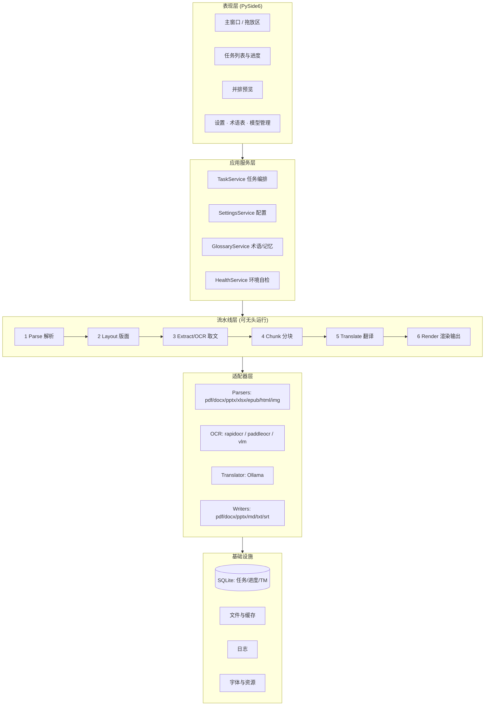

# 04 · 系统架构设计

版本 v1.0

## 1. 架构总览



**关键约束**：流水线层**不依赖任何 Qt 对象**，可在无头（headless）模式下被 CLI 或单元测试直接调用。

## 2. 分层职责

### 2.1 表现层（app/）
- 只做展示与交互，不含业务逻辑
- 通过 Qt 信号槽接收流水线进度事件（`page_done`、`block_done`、`error`、`eta`）
- 所有耗时操作必须走后台线程，主线程永不阻塞（全程可暂停/取消）

### 2.2 应用服务层（core/services/）
- `TaskService`：创建任务、调度、暂停/继续/取消、断点恢复
- `HealthService`：启动自检（Ollama 连通性、已装模型、OCR 就绪、磁盘空间）
- `SettingsService`：配置读写与迁移
- `GlossaryService`：术语表与翻译记忆（命中则跳过模型调用）

### 2.3 流水线层（core/pipeline/）
六个阶段，每阶段输入/输出都是 **DocIR**（见 05），阶段之间可独立缓存：

| 阶段 | 输入 | 输出 | 可缓存 |
|---|---|---|---|
| 1 Parse | 文件路径 | DocIR（含页面与原始块） | ✅ 落 SQLite |
| 2 Layout | DocIR | DocIR + 区域类型与阅读顺序 | ✅ |
| 3 Extract/OCR | DocIR | DocIR + 文本（含 OCR 结果） | ✅（最耗时，必缓存） |
| 4 Chunk | DocIR | 翻译批次列表（术语注入） | ❌（轻量） |
| 5 Translate | 批次 | DocIR + translated 字段 | ✅ 逐块落库 |
| 6 Render | DocIR | 输出文件 | ❌ |

**每一阶段均可单独重跑**，这是断点续翻的基础。

### 2.4 适配器层（core/parsers|ocr|translate|writers/）
- 统一抽象基类 + 注册表模式，新增格式只需实现接口并注册
- 所有适配器返回/消费 DocIR，互不感知

### 2.5 基础设施（core/store|infra/）
- SQLite 存储（WAL）
- 临时目录管理（平台标准目录 + 退出清理）
- 日志轮转与导出

## 3. 核心：DocIR 统一中间表示

所有格式先归一为 DocIR，再统一翻译，最后由各 Writer 输出。这是"支持所有格式"能落地的关键——**格式数量从 N×M 降为 N+M**。

（完整 schema 见 `05-数据模型与接口设计.md`）

## 4. 大文件流式处理机制（核心工程点）

```
打开文档 → 只读取页数与大纲（不加载内容）
   ↓
for page in range(0, N):                 # 逐页
    img = render(page)                   # 需要时才渲染
    blocks = parse_or_ocr(page)          # 本页文本块
    save_blocks_to_sqlite(page, blocks)  # 立即落盘
    del img, blocks                      # 立即释放
    if page % 10 == 0: emit_progress()   # 进度事件
   ↓
翻译阶段：for batch in chunk(blocks):    # 按 token 预算组批
    result = ollama.chat(batch)
    save_translation(result)             # 逐块落盘
   ↓
渲染阶段：按页生成 → 增量写入临时 PDF → 最后合并（避免一次性持有全部页面对象）
```

**内存护栏**：
- 位图渲染并发上限（默认 2）
- 预览 LRU 缓存（默认 50 页，超出淘汰）
- RSS 软阈值（默认 1.2 GB）：超过则降低渲染并发、强制 GC、跳过预览缓存
- 超过 300 MB / 800 页 → 自动分片处理（每片 200 页），片间合并输出

## 5. 并发模型

| 阶段 | 并发策略 |
|---|---|
| 渲染 + OCR | CPU 密集，线程池，默认 `min(4, cpu_count//2)` |
| 翻译 | IO 密集（等 Ollama），默认并发 2（Ollama 自身排队，并发过高无收益）；可配置 |
| 渲染输出 | 单线程（保证页码顺序与 PDF 合并安全） |
| UI | 主线程只做事件分发，全部耗时操作在 QThreadPool |

统一通过 `CancellationToken` 实现取消，各阶段在安全点检查。

## 6. 目录结构（编码阶段遵循）

```
linguaforge/
├── app/                        # PySide6 UI
│   ├── main.py                 # 入口
│   ├── windows/                # 主窗口、设置、模型管理、预览
│   ├── widgets/                # 拖放区、任务行、进度条
│   └── workers/                # Qt 后台任务封装
├── core/
│   ├── ir/                     # DocIR 定义与序列化
│   ├── parsers/                # pdf / docx / pptx / xlsx / epub / html / txt / image
│   ├── layout/                 # 版面区域分类、阅读顺序、列检测
│   ├── ocr/                    # base / rapidocr / paddleocr / vlm / preprocess
│   ├── translate/              # ollama_client / chunker / prompts / glossary / retry
│   ├── writers/                # pdf / docx / pptx / xlsx / md / txt / srt / epub
│   ├── pipeline/               # stages / orchestrator / scheduler / cancel
│   ├── store/                  # sqlite schema / dao / migration
│   └── infra/                  # config / logging / paths / fonts / metrics
├── resources/
│   ├── fonts/                  # Noto Sans SC 等（含 LICENSE）
│   ├── icons/
│   ├── i18n/                   # zh_CN.ts / en_US.ts
│   └── ocr_models/             # RapidOCR ONNX（随包）
├── packaging/
│   ├── win/                    # linguaforge.spec, inno_setup.iss
│   ├── mac/                    # mac.spec, build_dmg.sh, Info.plist, icon.icns
│   └── ci/                     # GitHub Actions workflows
├── tests/
│   ├── fixtures/               # 各类样例文档（小体积，<5MB/份）
│   ├── unit/  integration/  perf/
├── docs/                       # 本文档集
├── pyproject.toml
└── README.md
```

## 7. 关键设计决策记录（ADR 摘要）

| # | 决策 | 理由 | 被否决方案 |
|---|---|---|---|
| ADR-1 | 用 DocIR 统一中间表示 | 格式矩阵从 N×M 降为 N+M，新增格式成本线性 | 每种格式各写一套翻译逻辑 |
| ADR-2 | 逐页流式 + SQLite 落盘 | 满足"不限页数/大小"，天然支持断点 | 全量载入内存 |
| ADR-3 | 流水线层不依赖 Qt | 可无头测试与 CLI 复用 | UI 与逻辑耦合 |
| ADR-4 | 规避 PyMuPDF（AGPL） | 保持分发自由度 | PyMuPDF（性能更优但传染性） |
| ADR-5 | 不捆绑大模型权重 | 安装包体积可控，模型交给 Ollama 管理 | 内置 GGUF 权重 |
| ADR-6 | RapidOCR 默认 + 可切换 | 开箱即用、轻量、跨平台含 Apple Silicon | PaddleOCR 强制（体积大） |
| ADR-7 | 编号化批量翻译 + JSON 输出 | 减少请求数、保证条数对齐、便于失败重试 | 一句一请求（慢且易错） |

> **状态**：ADR-1 ~ ADR-7 均 **Accepted**（2026-10-21 定稿，2026-10-29 复核无变更）。更细的工程决策（含 ADR-014/015/016 与依赖治理）见 20 号 §3。
> **本文档与 20 号的分工**：本文档记录「架构形状」（分层、数据流、目录）；20 号记录「工程决策」（写法、异常、依赖、版本）。两者不重复描述。

---
**状态**：已确认 —— 分层与模块边界经 M0–M5 实践验证，无需调整；v2 只在既有分层内补 `core/problems.py`、`core/logging.py`、`core/paths.py`、`core/preflight.py` 四个新模块，不改架构形状。
